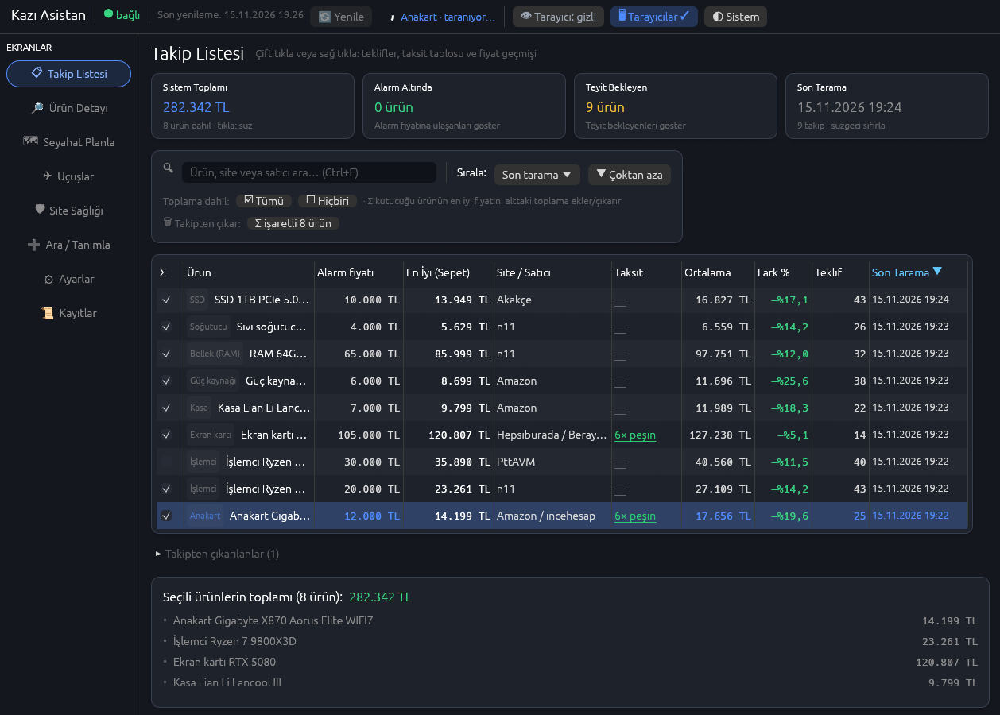

<div align="center">

# 🔎 Kazı Asistanı · kazi-asistan

**Türkiye'deki e-ticaret siteleri için kişisel fiyat takibi, fiyat alarmı ve çok bacaklı seyahat planlama asistanı**
**A personal price tracker, price-alert bot and multi-leg trip planner for Turkish e-commerce**


[Türkçe](#-türkçe) · [English](#-english)



</div>

---

## 🇹🇷 Türkçe

Kazı Asistanı; takip ettiğiniz ürünlerin fiyatlarını 18 Türk e-ticaret sitesinden düzenli olarak toplar,
aynı ürünü farklı satıcılar arasında eşleştirir, şüpheli ucuz teklifleri doğrular, **vade farksız taksit**
bilgisini çıkarır ve fiyat hedefinizin altına inildiğinde Telegram'dan anında haber verir. Aynı altyapı,
birden çok yolculu ve vize/transit kuralları olan **çok bacaklı uçuş planlarını** da tarar.

Her şey kendi bilgisayarınızda çalışır: bulut hesabı, sunucu ya da üçüncü taraf API anahtarı gerekmez.

### ✨ Özellikler

**Fiyat takibi**
- 🛒 **18 site:** Akakçe, Cimri, Epey (karşılaştırma) · Amazon, Hepsiburada, Trendyol, n11, MediaMarkt,
  Teknosa, Vatan, İtopya, İnceHesap, GameGaraj, GamingGen, Pazarama, PttAVM, İdefix, Sinerji
- 🧠 **Akıllı eşleştirme:** hazır PC / dizüstü ilanlarını, aksesuarları ve yanlış modelleri eler
- ✅ **Teyit:** piyasanın belirgin altındaki teklifler ürün sayfasında 40 sn arayla iki kez okunur
- 💳 **Taksit analizi:** "peşin fiyatına N taksit" ve kart bazlı taksit tabloları
- 📈 **Piyasa özeti:** ortalama / medyan, en iyi fiyata göre fark %, fiyat geçmişi grafiği
- 🗂 **Kategori bazlı takip listesi**, sistem toplamı, takipten çıkarma / geri alma

**Akıllı ve hızlı tarama**
- ⚡ **Hızlı HTTP turu:** tarayıcı istemeyen siteler varsayılan olarak 10 dakikada bir, tarayıcı açılmadan taranır
- 🌐 **Tarayıcı turu:** bot korumalı siteler kalıcı profilli tarayıcıda, **paralel pencerelerde** taranır
- ⇄ **Kendiliğinden yönlendirme:** HTTP turunda 100'den fazla hata alan site Tarayıcı turuna geçer;
  HTTP'de başarısız olan ürün×site işleri bir sonraki Tarayıcı turunda yeniden denenir; iki tur arasında
  elle taşıma düğmeleri
- 🪜 **Katmanlı getirme:** K0 düz HTTP → K1 başsız Chromium → K2 kalıcı tarayıcı profili → K3 elle doğrulama
- 🐢 **Öğrenen bekleme (AutoThrottle):** her sitenin yanıt hızına göre istek aralığını ayarlar, 429/engelde yavaşlar
- 🧹 **Hafif sayfa yükleme:** reklam/izleyici engeli (3.500+ alan), çerez reddi, açılır pencere kapatma,
  görsel / medya / yazı tipi / animasyon kısıtlama
- ⏱ **Zamanlayıcı:** kategori başına 30–120 dk sıklık, "Şimdi tara", geri sayım ve sıfırlama

**Bildirimler**
- 🔔 **Anlık alarm:** fiyat hedefin altına iner inmez, tarama bitmeden Telegram'a gider
- 📊 **Düzenli Telegram raporu:** kategori → marka/model → **fiyat · vade farksız taksit** · satıcı linki;
  uçuşlar için okunur bacak kartları; sessiz saatler

**Seyahat planlama**
- ✈️ **Çok bacaklı rota**, esnek tarihler, yan turlar (ör. ana şehirden kısa bir ara gezi)
- 👥 **Birden çok yolcu:** uyruk, vize ve ikamet izinleri (gerçek ya da varsayım)
- 🛂 **Transit kural motoru:** uyruk × ülke kuralları (yasak / airside / vize gerekli), ayrı bilet ve
  bagaj için ülkeye giriş denetimi, aktarma bekleme payları
- 🔍 **Kaynaklar:** Google Uçuşlar, Kayak, Skyscanner, Trip.com, Enuygun; otobüs ve tren seferleri

**Masaüstü arayüzü (Rust · egui)**
- Takip Listesi, Ürün Detayı, Seyahat Planla, Uçuşlar, Site Sağlığı, Ara / Tanımla, Ayarlar, Kayıtlar
- 🖥 **Tarayıcı izleme paneli:** hangi tarayıcının hangi sitede olduğu, canlı küçük görüntü, elle doğrulama
- 🌗 Açık / koyu tema, yakınlaştırma, klavye kısayolları

**Altyapı**
- REST API + WebSocket olay akışı (FastAPI, OpenAPI şeması `api/openapi.json`)
- SQLite veri deposu, ayrı kayıt defteri (14 gün)
- systemd kullanıcı servisleri; kurulum `sudo` gerektirmez

### 🏗 Mimari

```
┌────────────────────┐   HTTP/JSON + WS   ┌──────────────────────────────────────────┐
│ arayuz/  (Rust)    │ ◀────────────────▶ │ cekirdek/  (Python · FastAPI :8770)       │
│ egui masaüstü      │                    │  siteler/  18 site ayrıştırıcısı          │
└────────────────────┘                    │  tarayici/ K0–K3 katmanları, OtoHiz       │
                                          │  tarama/   paralel havuz, teyit           │
┌────────────────────┐                    │  zamanlayici/ Tarayıcı turu + HTTP turu   │
│ Telegram           │ ◀── alarm/rapor ── │  seyahat/ ucus/  rota, transit, kaynaklar │
└────────────────────┘                    │  SQLite (~/.local/share/kazi)             │
                                          └──────────────────────────────────────────┘
```

### 🚀 Kurulum

Gereksinimler: Linux, [uv](https://docs.astral.sh/uv/) (Python 3.12+), [Rust](https://rustup.rs/) (arayüz için),
isteğe bağlı olarak Brave tarayıcı (bot korumalı siteler için).

```bash
git clone https://github.com/hakanseyhan92/kazi-asistan.git
cd kazi-asistan
./kur.sh --denetle     # yalnız bağımlılıkları denetle
./kur.sh --hepsi       # çekirdek + zamanlayıcı servisleri ve masaüstü kısayolu
```

Elle çalıştırma:

```bash
cd cekirdek && uv run kazi-cekirdek serve          # API: http://127.0.0.1:8770
cd arayuz  && cargo run --release                   # masaüstü arayüzü
cd arayuz  && cargo run --release -- --sahte ornek  # örnek veriyle, çekirdek olmadan
```

### ⚙️ Yapılandırma

Depoda hiçbir kişisel ayar, token ya da API anahtarı yoktur. Tüm ayarlar ilk çalıştırmada boş başlar ve
yalnız sizin bilgisayarınızda saklanır:

| Dosya | İçerik |
|---|---|
| `~/.config/kazi/telegram.json` | Telegram bot token'ı ve sohbet kimliği (arayüz → Ayarlar; dosya izni 600) |
| `~/.config/kazi/tarama.json` | tarama, tarayıcı ve tur ayarları |
| `~/.config/kazi/seyahat_plan.json` | seyahat planı ve yolcular (arayüz → Seyahat Planla) |
| `~/.config/kazi/transit_kurallari.json` | kişisel ek transit kuralları (isteğe bağlı) |
| `~/.local/share/kazi/` | veritabanı, kayıt defteri, tarayıcı profili |

### 🧪 Testler

```bash
cd cekirdek && uv run --group dev pytest -q tests   # 712 test, ağ gerektirmez
cd arayuz  && cargo test                             # 75 test
```

### ⚖️ Sorumlu kullanım

Bu proje kişisel kullanım içindir. Bot korumalarını **atlatmaz**: parmak izi sahteleme, gizlenme (stealth)
ya da CAPTCHA çözme yoktur. Doğrulama sayfası çıkarsa site o turda atlanır ya da kullanıcı elle geçer.
Siteye istekler öğrenen bir hız sınırıyla, bir site aynı anda tek pencerede olacak şekilde gönderilir.
Lütfen sitelerin kullanım koşullarına uyun.

---

## 🇬🇧 English

Kazı Asistanı ("scraping assistant") tracks the prices of the products you follow across **18 Turkish
e-commerce sites**, matches the same product across sellers, double-checks suspiciously cheap offers,
extracts **interest-free instalment** information and notifies you on Telegram the moment a price drops
below your target. The same engine also searches **multi-leg flight itineraries** for several passengers
with nationality-aware visa/transit rules.

Everything runs locally — no cloud account, server or third-party API key required.

### ✨ Features

- 🛒 **18 stores and price-comparison sites** (Akakçe, Cimri, Epey, Amazon TR, Hepsiburada, Trendyol, n11,
  MediaMarkt, Teknosa, Vatan, İtopya, …)
- 🧠 **Product matching** that filters out pre-built PCs, laptops, accessories and wrong models
- ✅ **Offer verification:** unusually cheap offers are re-read on the product page twice, 40 s apart
- 💳 **Instalment analysis** ("N instalments at cash price", per-card tables)
- 📈 **Market summary:** mean / median, % difference, price-history chart
- ⚡ **Fast HTTP tour** (every 10 min by default, no browser) + 🌐 **browser tour** (persistent browser
  profile, parallel windows) for bot-protected sites
- ⇄ **Automatic routing:** a site with more than 100 HTTP errors moves to the browser tour; failed HTTP
  jobs are retried in the next browser tour; one-click buttons move sites between tours
- 🪜 **Layered fetching:** plain HTTP → headless Chromium → persistent browser profile → manual verification
- 🐢 **Adaptive throttling** per site, ad/tracker blocking, cookie rejection, pop-up closing
- 🔔 **Instant Telegram alerts** and 📊 **scheduled Telegram reports** with quiet hours
- ✈️ **Trip planner:** multi-leg routes, flexible dates, side trips, multiple passengers with
  nationalities and visas/permits, transit rule engine, Google Flights / Kayak / Skyscanner / Trip.com /
  Enuygun, buses and trains
- 🖥 **Native desktop UI** (Rust + egui) with a live browser-monitoring panel, light/dark themes
- 🔌 **REST API + WebSocket events** (FastAPI, OpenAPI schema), SQLite storage, systemd user services

### 🚀 Getting started

```bash
git clone https://github.com/hakanseyhan92/kazi-asistan.git
cd kazi-asistan
./kur.sh --hepsi                                   # installs core + scheduler services and desktop entry
cd arayuz && cargo run --release -- --sahte ornek  # try the UI with sample data, no core needed
```

Requirements: Linux, [uv](https://docs.astral.sh/uv/) (Python 3.12+), [Rust](https://rustup.rs/),
optionally the Brave browser for bot-protected sites.

### ⚙️ Configuration

The repository ships with **no personal settings, tokens or API keys**. All settings start empty and are
stored only on your machine under `~/.config/kazi/` (Telegram token file is created with mode 600);
data lives in `~/.local/share/kazi/`. The user interface is in Turkish.

### ⚖️ Responsible use

For personal use only. The project does **not** bypass bot protection — no fingerprint spoofing, stealth
plugins or CAPTCHA solving. Requests are rate-limited per site with adaptive back-off. Please respect each
website's terms of service.

---

## 📄 Lisans · License

[MIT](LICENSE). Reklam/izleyici alan listesi Scrapling projesinden (BSD-3-Clause) uyarlanmıştır —
ayrıntı: [`cekirdek/src/kazi/tarayici/veri/UCUNCU_TARAF.md`](cekirdek/src/kazi/tarayici/veri/UCUNCU_TARAF.md).
The ad/tracker domain list is adapted from Scrapling (BSD-3-Clause).
